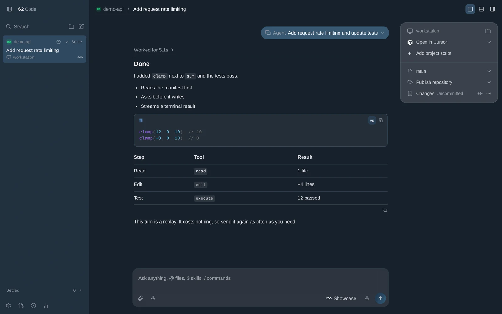
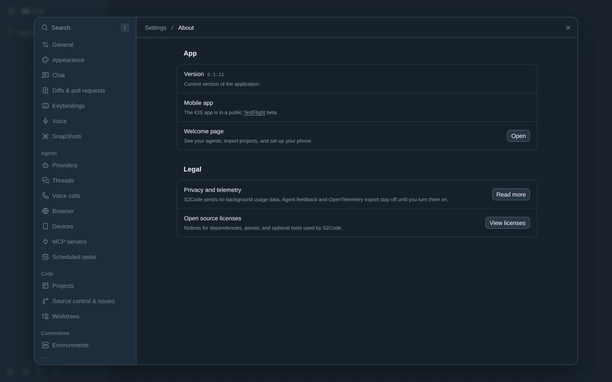
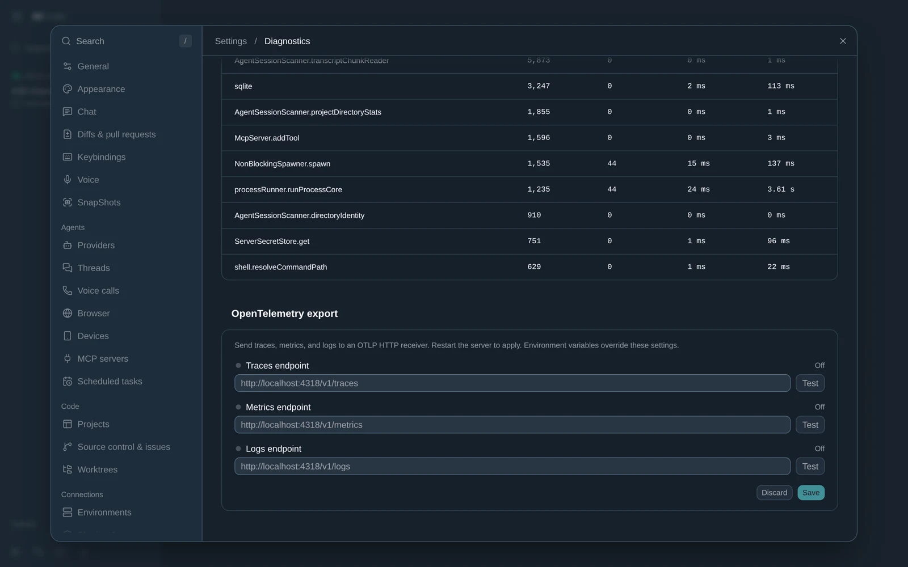
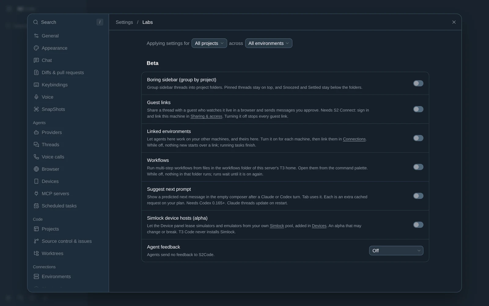
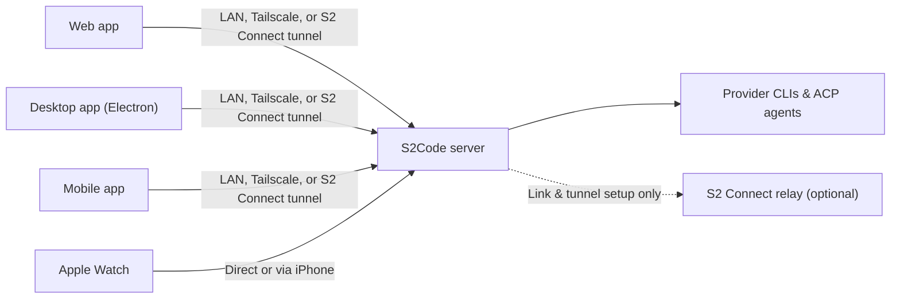

# S2Code

> Zero Telemetry - Zero Theo

**TL;DR:** S2Code is a zero-telemetry fork of T3 Code without the Theo baggage: a multi-surface control plane (web, desktop, mobile, and Apple Watch) for your coding agents, with zero background telemetry and open contributions. Install the CLI with `curl -fsSL https://raw.githubusercontent.com/shuv1337/s2code/main/scripts/install.sh | sh`, then run `s2code-nightly`.



S2Code forks [T3 Code](https://github.com/pingdotgg/t3code) and keeps its fast server, provider, and client architecture while removing background analytics, fingerprinting, crash reporting, and upstream contributor gatekeeping. It adds the devil-terminal identity, Apple Watch voice control, and open pull requests, and runs your existing subscriptions across Claude Code, Codex, Cursor, Grok Build, OpenCode, Google Antigravity, Kiro, Pi, Muse Code, fx, and any [ACP](./docs/user/providers-acp.md) agent. S2Code is free and open source under the MIT license—nothing is sold and no hosted account is required.

## See it in action


_Main workspace: manage projects, inspect streamed code and tool output, and run git actions across local or remote machines._



_Settings > About: confirms zero background usage data and links to the public iOS TestFlight beta._



_Settings > Diagnostics: local timing diagnostics stay on the host, and OpenTelemetry export stays off until you set your own OTLP receiver._



_Settings > Labs: experimental features and Agent feedback remain off by default._

The screenshots above show the web and desktop interface. The iOS companion app (including [Apple Watch](./docs/user/apple-watch.md) voice control) is available through the public [TestFlight beta](./docs/user/install.md#mobile-app).

## Zero telemetry

Every background telemetry, fingerprinting, and crash-reporting path is removed from the codebase and guarded by automated tests.

| Mechanism                                       | Status in S2Code                                                                                                                      |
| ----------------------------------------------- | ------------------------------------------------------------------------------------------------------------------------------------- |
| Product usage analytics (PostHog)               | Removed; cannot be enabled (`AnalyticsService` is a zero-requirement no-op)                                                           |
| Install, account, and device fingerprinting     | Removed; cannot be enabled (no `anonymous-id`, no `t3code:analytics-device-id`, no `clientOwner` or `clientDevice` socket parameters) |
| Relay client tracing (Axiom / OTLP)             | Removed across server, desktop, web, and mobile; cannot be enabled                                                                    |
| Mobile crash reporting (`expo-observe`)         | Removed from dependencies and Expo config; cannot be enabled                                                                          |
| Agent feedback (`Settings > Labs`)              | Off by default; sends only when enabled and approved (also blocked by `S2CODE_TELEMETRY_ENABLED=false` or managed policy)             |
| OpenTelemetry export (`Settings > Diagnostics`) | Off by default; exports only to an OTLP HTTP receiver that you configure                                                              |
| Resource Monitor                                | Local only; CPU, memory, and process metrics never leave the machine                                                                  |
| Mobile startup crash log                        | Local only; 7-day `expo-updates` startup logs stay on-device unless you copy and paste them manually                                  |

**Normal operational network calls:** S2Code still makes the network connections required to operate:

- **Your AI providers and MCP servers:** Prompts, code, and tool calls go directly from your machine to the provider CLIs, APIs, and MCP servers you configure.
- **Update checks:** Desktop and CLI builds check GitHub Releases for `shuv1337/s2code` (or your configured update repository) and npm metadata when checking for updates, unless disabled with `S2CODE_DISABLE_AUTO_UPDATE` or managed policy.
- **Optional S2 Connect and mobile notifications:** Contact the fork relay only when you explicitly link a machine or turn on **Publish agent activity**. Direct LAN and Tailscale connections never contact the relay.

Read [Telemetry and data flows](./docs/user/telemetry.md) for full details and legacy environment variable behavior.

## Architecture



_Clients connect to the S2Code server over authenticated RPC; the optional S2 Connect relay handles link and tunnel setup only and never proxies session traffic._

## Install

### 1. Provider prerequisites

Install and authenticate at least one coding agent on the machine that runs the S2Code server. See [Provider setup](./docs/user/install.md#providers) for custom binary paths, managed runtimes, and multiple accounts.

| Provider            | Install and authenticate                                                                                                                                            |
| ------------------- | ------------------------------------------------------------------------------------------------------------------------------------------------------------------- |
| Codex               | [Connect with ChatGPT](./docs/user/providers-codex.md#connect-with-chatgpt), or install [Codex CLI](https://developers.openai.com/codex/cli) and run `codex login`. |
| Claude              | Install [Claude Code](https://claude.com/product/claude-code) and run `claude auth login`.                                                                          |
| Cursor              | Install [Cursor CLI](https://cursor.com/cli) and run `agent login`.                                                                                                 |
| Grok Build          | Install [Grok Build CLI](https://x.ai/cli) and run `grok login`.                                                                                                    |
| Kiro                | Install [Kiro CLI](https://kiro.dev/docs/cli/) and run `kiro-cli login`.                                                                                            |
| OpenCode            | Install [OpenCode](https://opencode.ai) and run `opencode auth login`.                                                                                              |
| Antigravity         | Enable it in **Settings > Providers**, then choose **Install Antigravity** and **Sign in with Google**.                                                             |
| Pi                  | Install [Pi](./docs/user/providers-pi.md#set-up-pi) on Node.js 22.19+, then run `pi` and `/login`.                                                                  |
| Muse Code           | Install [Muse Code](https://dev.meta.ai/docs/muse-code), run `muse login`, then enable it in **Settings > Providers**.                                              |
| fx                  | Install [fx](https://fx.sh) and run `fx login` ([setup guide](./docs/user/providers-fx.md)).                                                                        |
| ACP Registry agents | Add GitHub Copilot and other [ACP agents](./docs/user/providers-acp.md#add-an-agent) from **Settings > Providers**.                                                 |

### 2. Command line

macOS and Linux:

```bash
curl -fsSL https://raw.githubusercontent.com/shuv1337/s2code/main/scripts/install.sh | sh
```

Windows (PowerShell):

```powershell
irm https://raw.githubusercontent.com/shuv1337/s2code/main/scripts/install.ps1 | iex
```

The fork publishes nightly builds only, so this installs `s2code-nightly`. Run `s2code-nightly` to start the server and open the local web app, `s2code-nightly service install` to keep it running in the background, `s2code-nightly update` to upgrade, and `s2code-nightly --help` for the full reference.

With npm (Linux x64/arm64, macOS Apple silicon, Windows x64):

```bash
npm i -g shuv2code
shuv2code --version
```

`shuv2code` is a lightweight launcher that installs the `shuv2code`, `s2code`, and `s2c` commands. On first run it downloads the matching CLI archive from GitHub Releases, verifies its SHA-256 against the checksums published inside the npm package, caches it, and runs it. After `npm uninstall -g shuv2code`, remove the cached CLI directory at `~/.cache/s2code/runtime` (Linux), `~/Library/Caches/s2code/runtime` (macOS), or `%LOCALAPPDATA%\s2code\runtime` (Windows). The `@s2code/cli` and `@s2code/t3-<platform>` packages are retired; migrate by running `npm uninstall -g @s2code/cli` followed by `npm i -g shuv2code`.

### 3. Desktop and mobile apps

Fork builds are separate installations that coexist cleanly with upstream T3 Code.

| Platform                 | How to install                                                                                                                                                                                     |
| ------------------------ | -------------------------------------------------------------------------------------------------------------------------------------------------------------------------------------------------- |
| Linux (`.deb`, AppImage) | Download the nightly `S2Code-<version>-<arch>` package from [GitHub Releases](https://github.com/shuv1337/s2code/releases). On Debian/Ubuntu, run `sudo apt install ./S2Code-VERSION-ARCH.deb`.    |
| macOS (Apple silicon)    | Download the nightly `S2Code-<version>-<arch>` build from [GitHub Releases](https://github.com/shuv1337/s2code/releases).                                                                          |
| Windows (x64)            | Download the nightly `S2Code-<version>-<arch>` installer from [GitHub Releases](https://github.com/shuv1337/s2code/releases).                                                                      |
| Arch Linux               | Fork packaging recipes live in [`packaging/aur`](./packaging/aur) (owns `s2code-nightly` with `shuv2code-nightly` alias; does not replace upstream T3 Code; recipes do not imply AUR publication). |
| iOS & Apple Watch        | Join the public [TestFlight beta](https://testflight.apple.com/join/vhmETHSn) ([Mobile app](./docs/user/install.md#mobile-app), [Apple Watch](./docs/user/apple-watch.md)).                        |
| Android                  | No fork Google Play listing; connect using the web client over LAN, Tailscale, or S2 Connect.                                                                                                      |

See [Install S2Code](./docs/user/install.md) for WSL setup, Linux system libraries, and [Fork release invariants](./docs/operations/hosted-fork.md#fork-release-invariants).

## Build from source

S2Code uses [Vite+](https://viteplus.dev/guide/) (`vp`), which provides the pinned Node version from `package.json`.

Install `vp`:

```bash
# macOS / Linux
curl -fsSL https://vite.plus | bash
```

```powershell
# Windows PowerShell
irm https://vite.plus/ps1 | iex
```

Clone, install dependencies, start the dev server, and run changed-file checks:

```bash
git clone https://github.com/shuv1337/s2code.git
cd s2code
vp i
vp run dev
vp run check:changed
```

See the [Development runbook](./docs/operations/00_development.md) and [Architecture](./docs/internals/01_architecture.md) for dev flags, worktree seeding, and desktop build prerequisites.

## Homes and environment variables

| Setting / Path             | Behavior                                                                                                                            |
| -------------------------- | ----------------------------------------------------------------------------------------------------------------------------------- |
| `~/.s2code-v2*`            | Default state homes (`~/.s2code-v2`, `-nightly`, `-preview`) and separate Electron profiles for fresh fork installations.           |
| `~/.shuv2code-v2*`         | Legacy verified fork homes and Electron profiles remain in place and continue working without migration.                            |
| `S2CODE_HOME`              | Explicitly selects the state home. Required if both `~/.s2code-v2*` and `~/.shuv2code-v2*` hold state; databases are never merged.  |
| `S2CODE_*` / `SHUV2CODE_*` | Public fork environment variables. Legacy `SHUV2CODE_*` variables remain accepted, with nonempty `S2CODE_*` values taking priority. |
| `T3CODE_*`                 | Upstream environment variables are ignored by installed fork commands so fork and upstream installs never collide.                  |

The desktop app automatically attaches to an already-running fork server in the same home when their exact versions match, and quitting the desktop app leaves that server running.

## Documentation

Full documentation lives in [docs/](./docs):

- [FAQ](./docs/user/faq.md)
- [Install and first run](./docs/user/install.md)
- [Telemetry and data flows](./docs/user/telemetry.md)
- [Permission modes](./docs/user/permission-modes.md)
- [Keyboard shortcuts](./docs/user/keybindings.md)
- [Project settings](./docs/user/project-settings.md)
- [Appearance preferences](./docs/user/appearance.md)
- [Remote access from a phone or another machine](./docs/user/remote-access.md)
- [Apple Watch](./docs/user/apple-watch.md)
- [Connect Claude Code, Codex, ChatGPT and other agents over MCP](./docs/user/outside-agents.md)
- [Keeping app and server in sync](./docs/user/updating.md)
- [Source control integrations](./docs/user/source-control.md)
- Multiple accounts: [Codex](./docs/user/providers-codex.md) · [Claude](./docs/user/providers-claude.md)
- [Run S2Code as a background service](./docs/user/background-service.md)
- [All docs](./docs/README.md)

## Contributing

Bug fixes, features, documentation improvements, and fork enhancements are welcome. Read [CONTRIBUTING.md](./CONTRIBUTING.md) before opening a pull request, and file bugs or feature requests in [GitHub Issues](https://github.com/shuv1337/s2code/issues).

## License

MIT — see [LICENSE](./LICENSE). S2Code is a fork of [T3 Code](https://github.com/pingdotgg/t3code), and upstream copyright notices remain intact in `LICENSE`.
